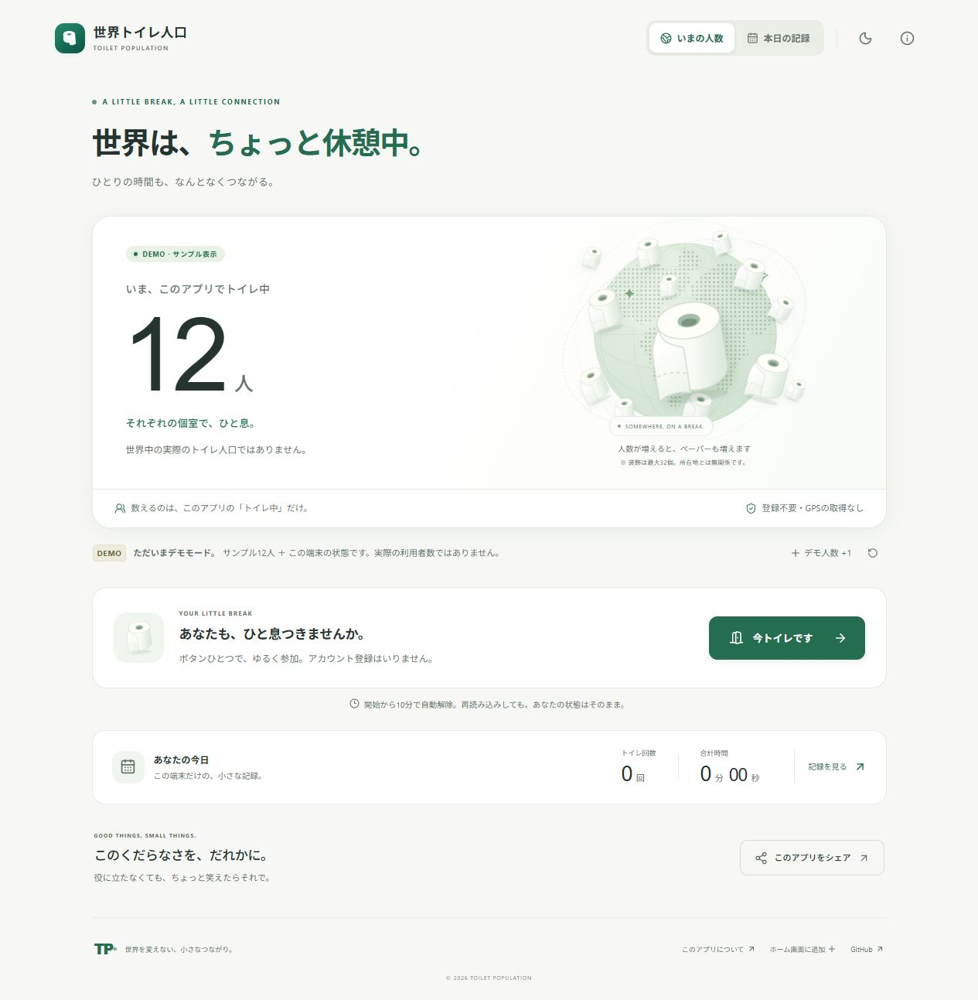
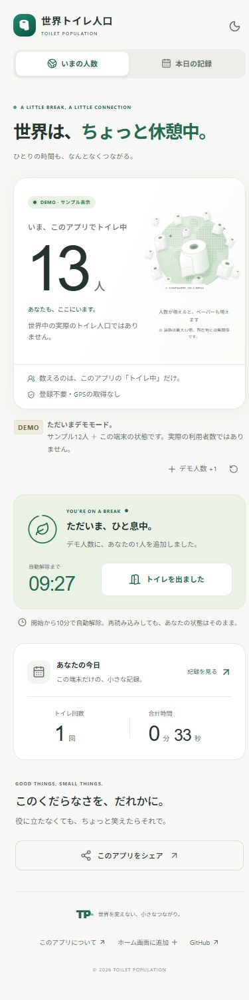
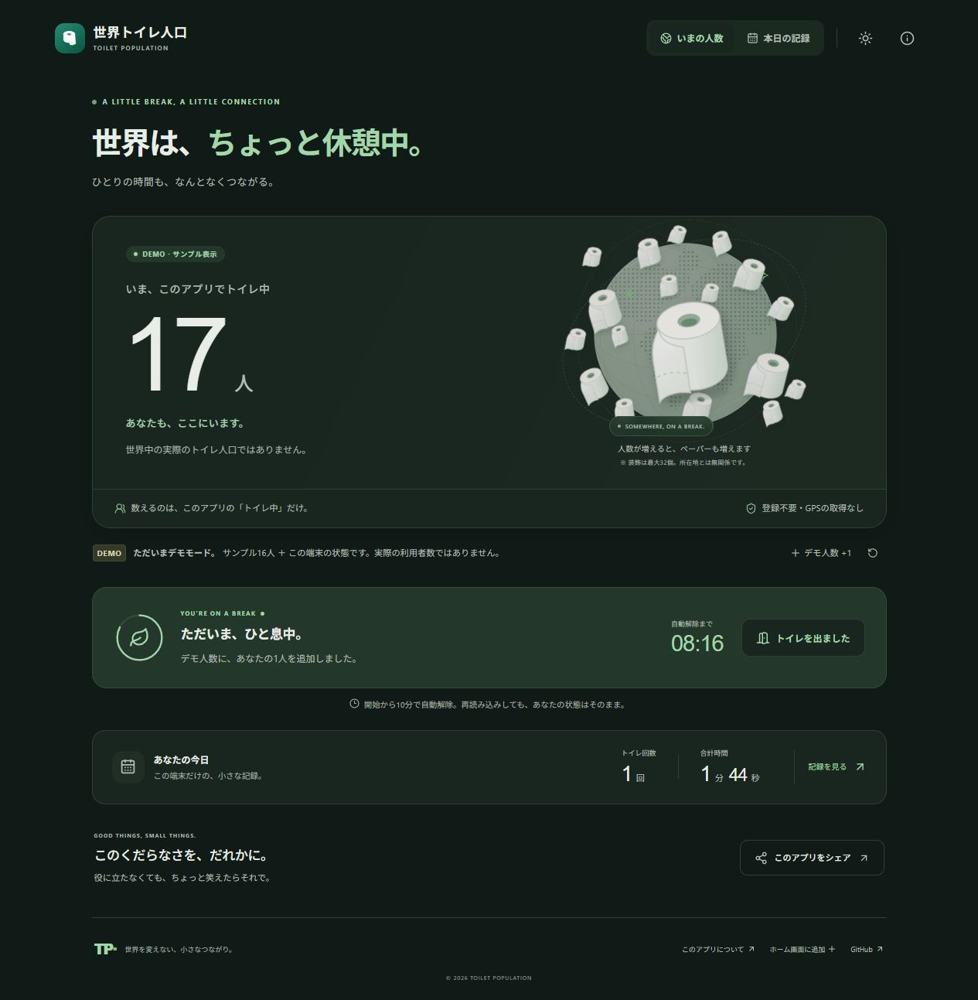
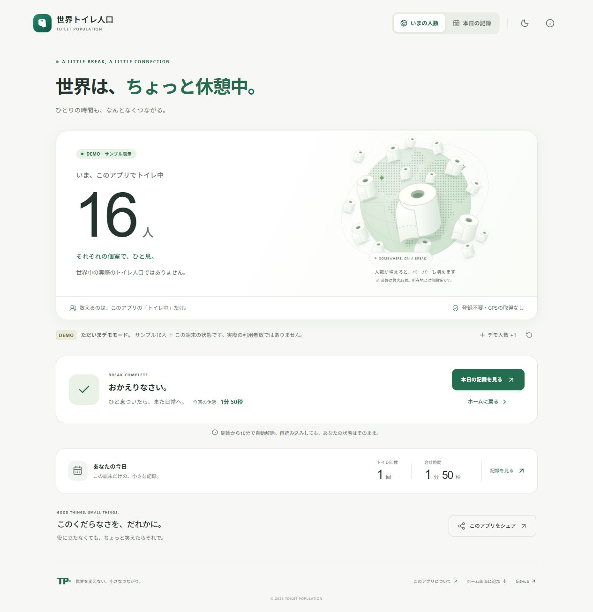
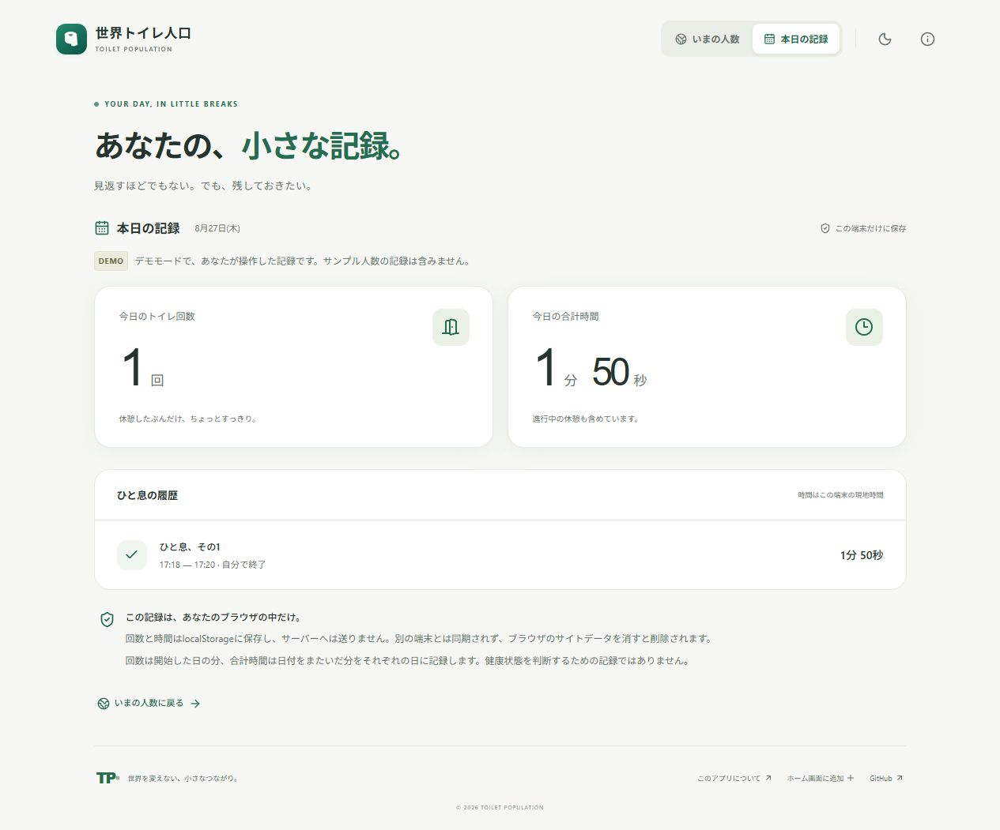

# 世界トイレ人口

ひとりの時間を、ちょっとだけ世界とつなぐ。

「今トイレです」を押したアプリ利用者の状態を共有する、清潔感のある小さなWebアプリです。

> 表示する人数は、**このアプリで現在トイレ中に設定している利用者数**です。世界中の実際のトイレ利用者数を調査・推計した統計ではありません。Firebase未設定時はデモモードとなり、人数を「サンプル人数」と明示します。

## 公開情報

<!-- PUBLISH_STATUS_START -->
- 公開アプリ: 公開・動作確認後に追記
- GitHub: リポジトリ公開後に追記
- Firebase: 未設定・デモモード。専用プロジェクト `toilet-population-kj` の新規作成を試みましたが、Google Cloudのプロジェクト作成数上限により作成できませんでした。既存の他アプリのプロジェクトや課金設定は変更していません。
- スクリーンショット: 公開アプリからの取得後に掲載内容を確認。
<!-- PUBLISH_STATUS_END -->

公開用の紹介文は[docs/publish-copy.md](docs/publish-copy.md)、データの扱いは[docs/privacy.md](docs/privacy.md)にまとめています。Tsukuttaへの掲載は未実施です。

## できること

- ワンタップで開始・終了。開始から10分後に自動で人数の対象外になる。
- Firebase設定時は、アプリ利用者の有効なセッションをリアルタイム同期。
- 経過時間・残り時間の表示、再読み込み・離脱後の状態復元。
- 本日の回数・合計時間をlocalStorageへ保存。デモとFirebaseの記録は分離。
- 人数に応じてトイレットペーパーが増える、小さな遊び心。
- モバイルファースト、ライト／ダークモード、キーボード操作・読み上げ・動きを減らす設定への配慮。
- 端末の共有機能とクリップボードによる共有。
- PWA用manifest・アイコン・favicon・OG画像。
- Vercel Analyticsへの開始・終了・共有イベント送信。

氏名・メールアドレスの登録は不要です。ブラウザーの位置情報APIを使わず、地図を思わせる装飾も実際の所在地を示しません。

## 技術構成

Next.js安定版のApp Router、TypeScript、Tailwind CSS、Firebase JavaScript SDK、Cloud Firestore、Firebase Anonymous Authentication、Vercel Analyticsを使用します。正確な採用バージョンは[package.json](package.json)と[package-lock.json](package-lock.json)を参照してください。

```text
ブラウザー
├─ 画面・PWA・共有
├─ localStorage: 自分の記録 / 復元用状態 / テーマ
├─ Anonymous Authentication: 同じブラウザーの匿名UID
└─ Firestore: activeSessions/{uid}
   ├─ startedAt: Timestamp
   └─ expiresAt: Timestamp
```

データベースに保存するフィールドは日時の2つだけです。Firebase Admin SDK、独自の認証サーバー、サービスアカウント鍵は不要です。

開始時は `startedAt` と `expiresAt` を同じサーバータイムスタンプにして非アクティブな予約を作り、サーバーで確定した開始日時に正確に10分を加えてトランザクションで有効化します。予約状態は人数に含めず、アクティブ状態の期限を任意に延長できないようにしています。

## ローカル起動

前提: Node.js 24、npm。Firestore RulesのエミュレーターテストにはJava 21も必要です。

```bash
npm ci
npm run dev
```

`http://localhost:3000` を開きます。Firebaseの環境変数が未設定なら、そのままデモを試せます。

Firebaseへ接続する場合は `.env.example` を `.env.local` へコピーし、公開設定を入力してください。

```bash
cp .env.example .env.local
```

PowerShellの場合:

```powershell
Copy-Item .env.example .env.local
```

`.env.local` をGitへ追加しないでください。

## デモモードとFirebaseモード

| 項目 | デモモード | Firebaseモード |
| --- | --- | --- |
| 画面上の明示 | 「デモモード」「サンプル人数」 | 接続状態とアプリ利用者数 |
| 人数 | 最初は12人のサンプル＋自分の状態。デモ用操作で増やせる | 有効な匿名UIDのセッション数 |
| 他の利用者との同期 | しない | Firestoreの変更を購読 |
| 状態・本日の記録 | このブラウザーに保存 | 状態はFirebase、記録はこのブラウザーに保存 |
| Firebaseへのセッション送信 | しない | 開始・終了・復元時に通信 |

デモ用の人数操作は説明付きの手動操作です。実際の他の利用者の活動として演出しません。Firebase設定がそろっていても接続できないときは、エラーや未接続状態を確認してください。「デモが動くこと」と「本番Firebaseで同期できること」は別の確認事項です。

## Firebase設定

### 1. 専用プロジェクトを用意する

この環境ではプロジェクト作成数の上限に達しているため、本番接続には作成枠の拡張か、利用者が指定する新しい専用Firebaseプロジェクトが必要です。既存の無関係なプロジェクトを削除・流用して回避しないでください。

1. Firebase Consoleでこのアプリ専用のプロジェクトを作成し、Webアプリを登録します。他アプリの本番プロジェクトを流用しないことを推奨します。
2. Authentication → Sign-in methodで「匿名」を有効にします。
3. Cloud Firestoreを作成し、利用するリージョンを選びます。安易な全公開テストルールのまま運用しないでください。
4. 必要に応じてAuthenticationの承認済みドメインへlocalhostと実際のVercelドメインを登録します。

### 2. 公開設定を登録する

「プロジェクトの設定 → マイアプリ → SDKの設定と構成」にある値を使用します。

| 環境変数 | 必須 | 内容 |
| --- | --- | --- |
| `NEXT_PUBLIC_APP_URL` | 公開時 | 実際のアプリのHTTPS URL |
| `NEXT_PUBLIC_FIREBASE_API_KEY` | はい | Firebase Web APIキー |
| `NEXT_PUBLIC_FIREBASE_AUTH_DOMAIN` | はい | Firebase Authドメイン |
| `NEXT_PUBLIC_FIREBASE_PROJECT_ID` | はい | 専用FirebaseプロジェクトID |
| `NEXT_PUBLIC_FIREBASE_APP_ID` | はい | Firebase WebアプリID |
| `NEXT_PUBLIC_FIREBASE_STORAGE_BUCKET` | いいえ | Web設定にある場合のみ。Storageは未使用 |
| `NEXT_PUBLIC_FIREBASE_MESSAGING_SENDER_ID` | いいえ | Web設定にある場合のみ。Messagingは未使用 |
| `NEXT_PUBLIC_FIREBASE_USE_EMULATORS` | いいえ | ローカル検証時だけ `true`。本番では `false` または未設定 |

`NEXT_PUBLIC_*` はビルド時にブラウザー用コードへ含まれる公開設定です。FirebaseのWeb APIキーを隠すことを認可の仕組みにしないでください。アクセス権はSecurity Rulesで守ります。サービスアカウントJSON、秘密鍵、管理者トークン、Vercel Tokenは絶対に入れません。[FirebaseのAPIキーの説明](https://firebase.google.com/docs/projects/api-keys)

### 3. Security Rulesとインデックスを適用する

このディレクトリから対象を明示して実行します。`YOUR_FIREBASE_PROJECT_ID` を専用プロジェクトIDへ置き換えてください。

```bash
npx firebase login
npx firebase deploy --only firestore:rules,firestore:indexes --project YOUR_FIREBASE_PROJECT_ID
```

[firestore.rules](firestore.rules)で次を制約します。

- ドキュメントIDは匿名認証のUID。自分のUIDのドキュメントだけを作成・更新・削除できる。
- 保存できるのはTimestamp型の `startedAt` と `expiresAt` のみ。任意の個人情報フィールドは拒否する。
- セッションの開始・期限・最大期間を検証する。1UIDにつきアクティブなドキュメントは1つ。
- 未認証のアクセスは拒否する。利用者は画面操作なしで匿名認証される。
- 匿名認証済み利用者の一覧読取を認め、人数表示に必要な日時だけを扱う。

Firestore Rulesはクエリ結果を後からフィルターするものではありません。本実装の一覧読取ルールは「期限切れデータを絶対に第三者が読めない」という保証ではなく、アプリ側の `expiresAt > 現在時刻` クエリと表示時の期限確認で人数から除外します。所有者以外の単一ドキュメント読取は有効なセッションに制限し、所有者は復元処理のため自身の期限切れドキュメントも読み取れます。[FirestoreのクエリとSecurity Rules](https://firebase.google.com/docs/firestore/security/rules-query)

`expiresAt` はクエリに必要なため、単一フィールドインデックスを無効にしないでください。TTLを設定するときもこのインデックスを維持します。

### 4. TTLによる期限切れドキュメントの後処理

1. Google Cloud Consoleで、専用プロジェクトのFirestoreデータベースを開きます。
2. **Time-to-live（有効期間） → Create Policy** を選択します。
3. コレクショングループに `activeSessions`、日時フィールドに `expiresAt` を指定します。
4. ポリシーを作成し、有効になることを確認します。

Google Cloud CLIを使う場合:

```bash
gcloud firestore fields ttls update expiresAt --collection-group=activeSessions --enable-ttl --project=YOUR_FIREBASE_PROJECT_ID
gcloud firestore fields ttls list --collection-group=activeSessions --project=YOUR_FIREBASE_PROJECT_ID
```

TTLは即時削除ではなく、通常は期限から24時間以内の後処理です。削除完了まではデータが残ります。[Firebase公式TTLガイド](https://firebase.google.com/docs/firestore/ttl)

TTL削除には無料枠がなく、利用には請求の有効化が必要です。無料SparkのままでTTL削除まで有効になったと考えないでください。このプロジェクトでは課金の有効化や有料プランへの変更は行っていません。TTLを利用する場合は運営者が料金を確認したうえで明示的に設定してください。アプリの10分解除と人数の除外はTTL待ちにせず、クエリとブラウザーの期限確認で行います。[Firestoreの無料枠・TTLの条件](https://firebase.google.com/docs/firestore/quotas)

### 5. 本番で同期を確認する

1. 異なるブラウザープロファイルで公開アプリを開き、デモ表示ではなくFirebaseへの接続済み表示を確認します。
2. 片方で開始し、もう片方の人数が増えることを確認します。
3. 開始側を再読み込みし、自分の状態と残り時間が復元されることを確認します。
4. 終了すると両方の人数が減ること、10分後も人数の対象外になることを確認します。
5. 異なるUIDへの書込、余分なフィールド、無効な日時、未認証読取がRulesで拒否されることをエミュレーターで確認します。

## 時間・記録・復元の仕様

- セッションは開始から最大10分。画面を閉じても期限は延長しません。
- 残り時間は期限日時から計算するため、バックグラウンドでタイマーが止まっても、復帰時に再計算できます。
- Firestoreクエリは `expiresAt > 現在時刻` で絞り、20秒ごとにクエリの基準時刻を更新します。取得後も最も早いセッション期限で人数を再計算し、画面復帰時にも期限を確認するため、TTL削除前の古いドキュメントを人数に含めません。
- 回数はブラウザーのローカル日付で開始日へ集計し、合計時間は日付をまたぐ場合に日ごとへ分割します。トイレ中の経過分も本日の表示へ反映します。
- 記録の識別子にUIDと開始時刻を使い、再読み込み・複数タブで同じセッションを二重計上しないようにします。
- サイトデータを削除すると匿名UIDや記録は失われます。別ブラウザー・別端末は別利用者として数えられるため、人数は「実在人物の一意な人数」を保証しません。
- 端末時刻のずれ、ネットワーク遅延、通信切断の影響があります。健康管理や厳密な統計の用途には使わないでください。

## PWAとオフライン

対応ブラウザーでは「ホーム画面に追加」などからインストールできます。manifest、アイコン、Service Workerを含みます。HTTPS（ローカル開発はlocalhost）で確認してください。

PWAはFirebaseの接続を不要にする機能ではありません。オフラインでは世界のアプリ利用者数を最新値として確認できません。通信が戻ったら再同期を確認してください。Firestore認証情報やAPIレスポンスをアプリの静的キャッシュへ保存しません。

## Analytics

開始・終了・共有のタイミングでVercel Analyticsのカスタムイベントを送信します。Firebase UID、氏名、メールアドレス、GPS情報はイベントに含めません。

Vercelのプロジェクト画面でWeb Analyticsを有効にしてください。**カスタムイベントの閲覧には対応するPro／Enterpriseプランが必要**と案内されています。Hobbyで公開する場合、送信コードがあってもイベントダッシュボードの利用を保証できません。受信確認前に「計測データを確認済み」とは扱わないでください。[Vercelのカスタムイベント](https://vercel.com/docs/analytics/custom-events)

Vercel/Firebaseなどの通信基盤はIPアドレスや端末情報を処理する場合があります。位置情報APIは利用しませんが、Vercel Analyticsには接続情報から推定する大まかな地域が含まれる場合があります。詳しくは[プライバシー説明](docs/privacy.md)を参照してください。

## 品質確認とSecret Scan

```bash
npm run lint
npm run typecheck
npm test
npm run secret:scan
npm run build
```

Rulesのテストは本番認証情報を使わず、Firestoreエミュレーターで実行します。

```bash
npm run test:rules
```

画面をエミュレーターへ接続する場合はFirebase設定をデモ用プロジェクトIDでそろえ、`NEXT_PUBLIC_FIREBASE_USE_EMULATORS=true` を設定します。[firebase.json](firebase.json)のAuth（localhost:9199）とFirestore（localhost:8187）を利用します。本番Vercelでこのフラグを有効にしないでください。

GitHub Actionsの[ci.yml](.github/workflows/ci.yml)でもNode.js 24で品質確認を実行し、別ジョブでJava 21＋Firestoreエミュレーターのアクセス制約を検証します。CIはデモ構成でビルドします。GitHubへのpush／pull requestで実行されるチェックであり、ローカルの成功だけでGitHub上の実行結果を保証するものではありません。

Secret Scanは[scripts/secret-scan.mjs](scripts/secret-scan.mjs)に実装した依存不要の検査です。

- 公開対象の作業ファイルに加え、独立Gitリポジトリがある場合はGit index内の実際のblobも検査します。ステージ後に作業ファイルだけを修正しても、古い秘密がindexに残っていれば失敗します。
- 秘密鍵、サービスアカウントJSON、一般的なプロバイダートークン、認証情報付きURL、秘密らしい代入値を検出します。
- 追跡対象の `.env` や秘密鍵ファイルを拒否します。`.env.example` は検査対象です。
- 問題があっても値をログへ出さず、ファイル名・行番号・検査名だけを出します。
- 依存・ビルド生成物・バイナリを除外します。既知の形式を検査する補助であり、未知の秘密やGit履歴全体、画像内の文字の安全を保証しません。漏えい時はファイルを消すだけでなく資格情報を失効・再発行してください。

検査器の自己テスト:

```bash
node scripts/secret-scan.mjs --self-test
```

## Vercelへ公開する

1. この `toilet-population` ディレクトリだけを独立したGitHubリポジトリとして公開します。親の別アプリを含めないでください。
2. Vercelで当該GitHubリポジトリをImportします。Framework PresetはNext.js、Node.jsは24、Root Directoryはリポジトリ直下です。
3. `NEXT_PUBLIC_APP_URL` に実際の公開URLを設定します。Firebaseを利用する場合のみ上記のFirebase公開設定をProduction／必要なPreviewへ登録します。
4. デプロイします。`NEXT_PUBLIC_*` の変更は再ビルド・再デプロイが必要です。
5. 公開URLで初期画面・開始・終了・復元・本日の記録・共有・ダークモード・モバイル表示を確認します。
6. Firebaseのライブ同期を有効にする場合はRules・TTL・匿名認証・ドメイン設定を確認し、別ブラウザー同士で同期テストを行います。
7. 下記5枚を実際の公開アプリから撮影し、READMEの公開情報と紹介文のURLを更新します。

CLIで公開する場合もこのディレクトリでVercelへリンクしてから実行します。`vercel --prod` は本番公開の操作です。既存の別プロジェクトへ誤ってリンクしないよう、対象名を確認してください。CI自体にはVercel/Firebaseの管理者トークンを保存しません。

## スクリーンショット

以下は公開アプリから取得する5つの画面です。公開環境がデモの場合、画像内の人数もサンプルであり、実際の複数利用者の参加実績ではありません。

### 1. 初期画面



### 2. トイレ中状態



### 3. 人数表示



### 4. 終了画面



### 5. 本日の記録



## 運用上の制限

- 匿名UIDの発行は実在人物の証明ではありません。複数端末・サイトデータの削除・自動操作による人数の水増しを完全には防げません。
- 人数同期は有効セッションの読取を行う小規模構成です。利用者が増えるとFirestoreの読取・接続・通信コストが増えるため、公開後は使用量・予算通知を確認してください。大規模運用には集約方式やApp Checkなどの追加設計が必要です。
- デモのスクリーンショット、単体テスト、Rulesエミュレーターの成功は本番Firebase接続の証明ではありません。
- 本日の記録は端末内だけに保存され、バックアップ・端末間同期はありません。
- Vercel Analyticsのイベント可視化はプランと設定に依存します。
